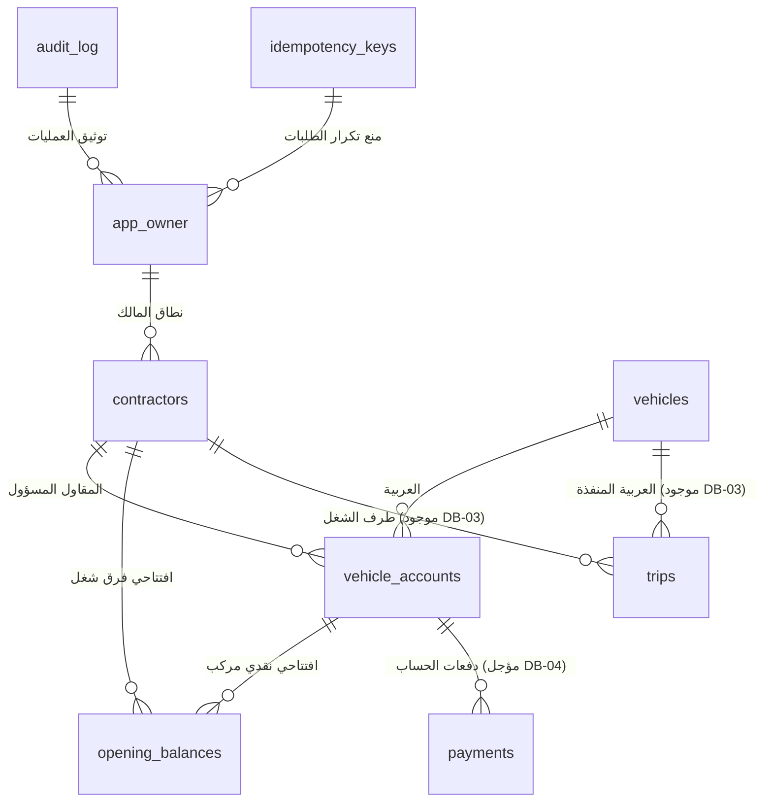

# وثيقة تصميم نموذج البيانات وقاعدة البيانات — محدثة لمهمة DB-02-SCHEMA

**الحالة (٥ نوفمبر ٢٠٢٦ / H038):** توثيق عقود A/B التاريخية وDB-03/C الموجودة فعليًا على main، مع إصلاح وصفي إضافي H038 في PR #1 (نجح في الاختبار المعزول، غير مدموج). لا Supabase Auth أو حفظ دائم بعد؛ انظر STATUS.
**المرجع المحاسبي الوحيد:** [ACCOUNTING_RULES](ACCOUNTING_RULES.md).
**القرارات الحاكمة:** [DECISIONS](DECISIONS.md) (خاصة A01–A06, A12, D01–D05, D09, D13, D13-B, D14, A13-R1، مع بقاء D15 وD16 معلقين دون حسم مسبق).

---

## ١. مبدأ الفصل المالي الصارم (Financial Separation)

يقوم التصميم على الفصل الحاسم والمطلق بين مسارين ماليين مستقلين تمامًا، لا يجوز خلطهما أو إجراء مقاصة تلقائية بينهما:

```
┌────────────────────────────────────────────────────────────────────────┐
│                        النقلة الواحدة (Trip Record)                    │
│   (تاريخ، طريق، أطنان، اتجاه، مقاول طرف، عربية، سعران، مصاريف نقلة)    │
└──────────────────┬─────────────────────────────────┬───────────────────┘
                   │                                 │
                   ▼                                 ▼
   ┌───────────────────────────────┐ ┌───────────────────────────────────┐
   │    أ) فرق الشغل بين المقاولين  │ │   ب) حساب النقد الخاص بالعربية    │
   │  (بين أحمد أبو علي والمقاول K)  │ │ (العربية لدى المقاول المسؤول حصراً)│
   ├───────────────────────────────┤ ├───────────────────────────────────┤
   │ • يحسب من: سعر المقاول × أطنان │ │ • يحسب من: سعر العربية × أطنان   │
   │   + مصاريف النقلة             │ │   + مصاريف النقلة المستردة      │
   │ • التسوية: بالشغل المتبادل   │ │ • التسوية: بالدفعات النقدية       │
   │ • الرصيد: مستمر عبر الفترات   │ │ • المفتاح: (العربية، المقاول)     │
   │ • الدفعات النقدية لا تمسه     │ │ • ممنوع تجاوز المستحق (A12)      │
   └───────────────────────────────┘ └───────────────────────────────────┘
```

### القواعد الملزمة للفصل المالي:
1. **لا خصم للدفعات النقدية من فرق شغل المقاولين:** دفعات العربيات النقدية تخص فقط حساب العربية عند المقاول الذي يحاسبها. فرق الشغل بين أحمد والمقاول الآخر يُسوّى بالعمل المتبادل ولا يتأثر إطلاقًا بأي دفعة نقدية سددها أحمد أو المقاول لسائق أو مالك عربية.
2. **تحديد المقاول المسؤول نقديًا عن العربية بحسب اتجاه الشغل:**
   - **الاتجاه الأول (`AHMED_SUPPLIES` — أحمد أحضر العربية لشغل المقاول K):**
     * **فرق الشغل:** قيمة النقلة تسجل **لصالح أحمد** (على المقاول K).
     * **المقاول المسؤول عن العربية:** **أحمد أبو علي**؛ هو الذي أحضر العربية وهو المسؤول حصرًا عن سداد مستحقاتها النقدية.
   - **الاتجاه الثاني (`OTHER_SUPPLIES` — المقاول K أحضر العربية لشغل أحمد):**
     * **فرق الشغل:** قيمة النقلة تسجل **لصالح المقاول K** (على أحمد).
     * **المقاول المسؤول عن العربية:** **المقاول K**؛ هو الذي أحضر العربية وهو المسؤول حصرًا عن سداد مستحقاتها النقدية.
3. **عزل حساب نفس العربية لدى المقاولين المختلفين:**
   - إذا عملت العربية (ع١) مع أحمد ومع المقاول (محمد)، فإن حساب `(ع١، أحمد)` مستقل تمامًا وبمعزل كلي عن حساب `(ع١، محمد)`.
   - لا يجوز تحويل رصيد أو مديونية بين الحسابين، ولا يُسدد استحقاق لدى مقاول من دفعات مقاول آخر.
4. **خانة مصاريف النقلة الواحدة (D05 وUI-03):**
   - حقل مالي واحد للنقلة (`expense_egp` / `expense_piastres`) يمثل ما دفعته العربية أو السائق في الرحلة (كارتات ميزان، كارتات بوابات، كباش، إكراميات مستردة) وسيُرد لها ضمن مستحقاتها.
   - يضاف هذا المبلغ مرة واحدة لكل من قيمة شغل المقاول ومستحق العربية طبقًا لـ [ACCOUNTING_RULES](ACCOUNTING_RULES.md#a01). لا يوجد عمود كارتات منفصل.
   - المصروف الذي يدفعه المقاول مباشرة من جيبه خارج النطاق ولا يدخل في حساب العربية.
5. **استقلال السعرين وحالة الربط (D14):**
   - تدعم النقلة: `contractor_rate_egp` و`vehicle_rate_egp` وخيار `same_rate` (مفعل افتراضيًا).
   - عند تفعيل «نفس السعر» يفرض الخادم تساويهما؛ وعند فصله يستقل كل سعر بقيمته.
   - البيانات المشتركة (`shared_data`) وسيلة واجهة اختيارية بحتة لتسهيل الإدخال السريع؛ لا تنشئ سجلًا ماليًا في القاعدة، ولا تُورث تلقائيًا ليوم جديد (A13-R1).

---

## ٢. الكيانات والعلاقات التفصيلية (Entities & Relational Schema)

التصميم مخصص لـ **مستخدم واحد معتمد (Single Authorized Owner)**، دون طبقات تعقيد عامة أو جداول شركات متعددة أو أدوار متعددة.



### ١. كيان المالك المحمي (`app_owner`) — أساس الصلاحيات
- **الغرض:** تحديد المستخدم المالك المعتمد للمنظومة على مستوى قاعدة البيانات بشكل صارم، دون الاعتماد على البريد الإلكتروني أو بيانات البيانات الوصفية (`user_metadata`) القابلة للتغيير.
- **المعرف الأساسي:** `id integer primary key default 1 check (id = 1)` لضمان وجود صف إعدادات واحد فقط.
- **الحقول:**
  * `id` (`integer`, PK, Check `id = 1`).
  * `owner_user_id` (`uuid`, Nullable): معرف المالك الفعلي في نظام المصادقة. **تصحيح BUILD-01/A:** لا يوجد مفتاح خارجي فعلي نحو `auth.users` في الـ migrations؛ المرجع منطقي ويُتحقق منه داخل `app_set_initial_owner` بفحص مشروط لوجود الجدول، حتى تعمل الـ migrations على PostgreSQL معزول كما تعمل على Supabase. سبب القرار: ملكية `auth` تتبع Supabase ولا يُربط مخطط الأعمال بها بقيد حذف يمنع إدارة المستخدم. يمنع الفحص تعيين مالك غير موجود عند توفر جدول المصادقة.
  * `initialized_at` (`timestamptz`, Nullable): تاريخ ضبط المالك لأول مرة عبر الإجراء الإداري المحمي.
  * `created_at` (`timestamptz`, Not Null, Default `now()`).
- **القواعد:**
  * إذا كان `owner_user_id IS NULL`، يُحظر الوصول تمامًا عن أي مستخدم (Fail-Closed).
  * لا يمكن لأي مستخدم من العميل قراءة أو تعديل هذا الجدول؛ RLS مفعل ولا توجد سياسات عامة.
  * التهيئة تتم عبر دالة إدارية محمية `app_set_initial_owner` مسحوبة الصلاحيات من `PUBLIC` و`authenticated` و`anon`.

### ٢. كيان المقاولين (`contractors`)
- **الغرض:** حفظ هوية المقاولين المتعامل معهم، وتمييز طرف «أحمد أبو علي» الثابت في النظام كطرف أساسي.
- **المعرف الأساسي:** `id text primary key` (مثل `K1`, `K2` أو UUID نصي متوافق مع الحزم الحالية).
- **الحقول:**
  * `id` (`text`, Primary Key).
  * `name` (`text`, Not Null, Check `trim(name) <> ''`): اسم المقاول ثلاثي أو تجاري للعرض والبحث.
  * `is_primary` (`boolean`, Not Null, Default `false`): قيمة `true` فقط لسجل «أحمد أبو علي».
  * `is_archived` (`boolean`, Not Null, Default `false`): أرشفة ناعمة وفق D03.
  * `created_at` (`timestamptz`, Not Null, Default `now()`).
  * `updated_at` (`timestamptz`, Not Null, Default `now()`).
- **القيود والفهارس وحماية الهوية:**
  * **حماية المقاول الأساسي:**
    - قيد تحقق صارم: المقاول الأساسي لا يمكن أرشفته `check (not (is_primary and is_archived))`.
    - قيد تفرد جزئي يضمن وجود مقاول أساسي واحد فقط في النظام ككل:
      `create unique index idx_contractors_single_primary on public.contractors ((1)) where is_primary = true;`
    - منع حذف المقاول الأساسي بأي حال، وتمنع النقلات المستقبلية جعله طرفًا مقابلًا لنفسه.
  * **فهرس البحث عن الاسم:**
    - الاسم ليس رقمًا قوميًا؛ قد يتشابه اسمان لمقاولين مختلفين. لا يُفرض قيد `UNIQUE` تعسفي على الاسم في قاعدة البيانات بدون قرار تجاري صريح.
    - يُنشأ فهرس بحث سريع: `create index idx_contractors_name_search on public.contractors (lower(trim(name))) where not is_archived;`.
    - التحذير من تكرار الاسم يكون في الواجهة، دون منع حفظ شخصين مختلفين بنفس الاسم.
  * منع الحذف الصلب لأي مقاول مرتبط بمعاملات مالية (`ON DELETE RESTRICT`).

### ٣. كيان العربيات وبيانات السائق (`vehicles`)
- **الغرض:** حفظ بيانات الشاحنات وأرقام اللوحات واسم السائق المتفق عليه.
- **المعرف الأساسي:** `id text primary key` (مثل `V1`, `V2` أو UUID نصي).
- **الحقول:**
  * `id` (`text`, Primary Key).
  * `plate_number` (`text`, Not Null, Check `trim(plate_number) <> ''`): رقم اللوحة.
  * `driver_name` (`text`, Nullable): اسم السائق الحالي المعتاد (اختياري).
  * `notes` (`text`, Nullable): ملاحظات تعريفية.
  * `is_archived` (`boolean`, Not Null, Default `false`): أرشفة ناعمة (D03).
  * `created_at` (`timestamptz`, Not Null, Default `now()`).
  * `updated_at` (`timestamptz`, Not Null, Default `now()`).
- **القيود وتطبيع اللوحات:**
  * تطبيع رقم اللوحة (حذف المسافات المكررة وضبط المسافات الداخلية):
    `create unique index idx_vehicles_plate_active on public.vehicles (lower(regexp_replace(trim(plate_number), '\s+', ' ', 'g'))) where not is_archived;`
  * أرشفة العربية تحافظ على تاريخ معاملاتها كاملًا، وإعادة تفعيلها تخضع لفحص عدم تعارض اللوحة مع عربية نشطة أخرى.
  * منع الحذف الصلب لأي عربية مرتبطة بحسابات أو معاملات (`ON DELETE RESTRICT`).

### ٤. كيان حساب العربية لدى المقاول المسؤول (`vehicle_accounts`)
- **الغرض:** التجسيد العلائقي المباشر لمفتاح حساب النقد `(vehicle_id, contractor_id)`. يعمل كمرسى أقفال تسلسلية (Row Mutex) لمنع التنافس على الرصيد، وكمرجع ترابطي موثوق للأرصدة الافتتاحية والدفعات.
- **المعرف الأساسي المركب:** `(vehicle_id, contractor_id)`
- **الحقول:**
  * `vehicle_id` (`text`, Not Null, References `public.vehicles(id)` ON DELETE RESTRICT).
  * `contractor_id` (`text`, Not Null, References `public.contractors(id)` ON DELETE RESTRICT).
  * `created_at` (`timestamptz`, Not Null, Default `now()`).
  * `last_activity_at` (`timestamptz`, Not Null, Default `now()`).
- **الإنشاء الآمن المتزامن:**
  * لضمان عدم حدوث تصادم أو فشل إذا حاول طلبا نقلات متزامنان تسجيل نفس العربية لدى المقاول لأول مرة، يُنشأ السجل بنمط:
    `INSERT INTO public.vehicle_accounts (vehicle_id, contractor_id) VALUES (...) ON CONFLICT (vehicle_id, contractor_id) DO NOTHING;`
- **ملاحظة معمارية حاسمة:** **لا يوجد عمود رصيد يدوي قابل للتعديل المباشر** في هذا الجدول. الرصيد مشتق دائمًا بمعادلة نقية من الافتتاحي والنقلات والدفعات.

### ٥. كيان الأرصدة الافتتاحية (`opening_balances`)
- **الغرض:** تخزين الرصيد الابتدائي القديم قبل بدء تفاصيل الشغل (وفق D04).
- **المعرف الأساسي:** `id text primary key` (أو UUID).
- **الحقول:**
  * `id` (`text`, Primary Key).
  * `balance_type` (`text`, Not Null, Check in `('CONTRACTOR_WORK', 'VEHICLE_CASH')`).
  * `contractor_id` (`text`, Not Null, References `public.contractors(id)` ON DELETE RESTRICT).
  * `vehicle_id` (`text`, Nullable, References `public.vehicles(id)` ON DELETE RESTRICT).
  * `start_date` (`date`, Not Null): تاريخ القطع (`YYYY-MM-DD`).
  * `signed_piastres` (`bigint`, Not Null): المبلغ بالقرش كعدد صحيح بإشارة:
    - لفرق شغل المقاول: الموجب لصالح أحمد، والسالب لصالح المقاول الآخر.
    - لنقد العربية: الموجب مستحق للعربية (لها)، والسالب دين على العربية (عليها).
  * `notes` (`text`, Nullable): بيان أصل الرصيد القديم.
  * `is_cancelled` (`boolean`, Not Null, Default `false`): وسم الإلغاء المحفوظ (D03).
  * `cancel_reason` (`text`, Nullable): سبب الإلغاء الإلزامي عند إلغاء الافتتاحي.
  * `cancelled_at` (`timestamptz`, Nullable): تاريخ ووقت الإلغاء.
  * `version` (`integer`, Not Null, Default `1`): رقم الإصدار للتحكم بالتزامن.
  * `created_at` (`timestamptz`, Not Null, Default `now()`).
  * `updated_at` (`timestamptz`, Not Null, Default `now()`).
- **القيود والعلاقات المركبة:**
  * **الربط المركب لحساب العربية:** في حالة `VEHICLE_CASH`، يرتبط السجل بحساب العربية الفعلي عبر مفتاح خارجي مركب يمنع إنشاء افتتاحي لحساب غير موجود:
    `foreign key (vehicle_id, contractor_id) references public.vehicle_accounts(vehicle_id, contractor_id) on delete restrict`
  * **قيد التحقق من نوع الحساب:**
    `check ((balance_type = 'CONTRACTOR_WORK' and vehicle_id is null) or (balance_type = 'VEHICLE_CASH' and vehicle_id is not null))`
  * **قيد سبب الإلغاء:**
    `check (not is_cancelled or (cancel_reason is not null and trim(cancel_reason) <> ''))`
  * **الفهارس الفريدة للأرصدة النشطة فقط:**
    - للمقاول: `create unique index idx_opening_contractor_active on public.opening_balances (contractor_id) where balance_type = 'CONTRACTOR_WORK' and not is_cancelled;`
    - للعربية: `create unique index idx_opening_vehicle_account_active on public.opening_balances (contractor_id, vehicle_id) where balance_type = 'VEHICLE_CASH' and not is_cancelled;`
  * **تحويل الافتتاحي إلى تفاصيل (D04):** لا يُنفذ كود تحويل الآن؛ تفاصيل التحويل تظل تصميمًا مقترحًا يحتاج مراجعة قبل البرمجة.

### ٦. كيان سجل التعديل والتدقيق (`audit_log`)
- **الغرض:** سجل رقابي غير قابل للتعديل أو المسح (`Append-Only`) يوثق كافة العمليات الحساسة.
- **المعرف الأساسي:** `id bigint generated always as identity primary key`.
- **الحقول:**
  * `id` (`bigint`, Primary Key).
  * `entity_type` (`text`, Not Null, Check in `('CONTRACTOR', 'VEHICLE', 'VEHICLE_ACCOUNT', 'OPENING_BALANCE', 'TRIP', 'PAYMENT', 'SETTINGS')`).
  * `entity_id` (`text`, Not Null): معرف السجل محل العملية.
  * `action` (`text`, Not Null, Check in `('INSERT', 'UPDATE', 'CANCEL', 'CONVERT_OPENING')`).
  * `reason` (`text`, Nullable): سبب العملية (إلزامي في الإلغاء وتصحيح الشغل).
  * `old_data` (`jsonb`, Nullable): لقطة السجل قبل التعديل/الإلغاء.
  * `new_data` (`jsonb`, Nullable): لقطة السجل بعد التعديل.
  * `diff` (`jsonb`, Nullable): ملخص التغيرات.
  * `financial_impact` (`jsonb`, Nullable): الأثر المالي على الأرصدة.
  * `performed_by` (`uuid`, Not Null): معرف المستخدم المنفذ. **تصحيح BUILD-01/A:** مرجع منطقي دون مفتاح خارجي فعلي نحو `auth.users` (انظر ملاحظة `app_owner` أعلاه)؛ يُمرّر من `auth.uid()` داخل دوال RPC المحمية.
  * `created_at` (`timestamptz`, Not Null, Default `now()`).
- **الحماية والصلاحيات:**
  * محمي بالكامل من أي تعديل أو حذف أو إدراج مباشر من العميل؛ الإدراج يتم حصريًا عبر دوال الخادم المعتمدة (`SECURITY DEFINER`).

### ٧. كيان معرفات محاولات الحفظ ومنع التكرار (`idempotency_keys`)
- **الغرض:** منع تكرار تنفيذ العمليات المالية عند إعادة المحاولة بعد انقطاع الاتصال أو النقر المزدوج (W01, W05).
- **المعرف الأساسي:** `key text primary key` (UUID يرسله العميل مع كل محاولة حفظ منطقية).
- **الحقول:**
  * `key` (`text`, Primary Key).
  * `user_id` (`uuid`, Not Null): مرجع منطقي دون مفتاح خارجي فعلي نحو `auth.users` (تصحيح BUILD-01/A، انظر ملاحظة `app_owner`).
  * `operation` (`text`, Not Null): نوع العملية (مثل `ADD_CONTRACTOR`, `ADD_VEHICLE`, `CREATE_TRIP`).
  * `payload_hash` (`text`, Not Null): البصمة **الفعلية في Phase B** هي `md5(operation || '|' || payload::text)` على JSONB القياسي؛ هذا معرّف تطابق/منع تكرار **وليس توقيعًا أمنيًا أو SHA-256**.
  * `status` (`text`, Not Null, Check in `('PROCESSING', 'COMPLETED', 'FAILED')`).
  * `response_status` (`integer`, Nullable): كود الرد المحفوظ (مثل 200, 400).
  * `response_body` (`jsonb`, Nullable): الرد المخزن لإعادته للعميل عند تكرار نفس الطلب السليم.
  * `created_at` (`timestamptz`, Not Null, Default `now()`).
  * `updated_at` (`timestamptz`, Not Null, Default `now()`).
- **سياسة الاحتفاظ والحماية (تصحيح DB-01-PREP):**
  * **إلغاء الحذف التلقائي بعد ٧ أيام:** تحتفظ المنظومة بمفاتيح العمليات المالية المكتملة بصورة دائمة لمنع تكرار أي طلب قديم يصل متأخرًا.
  * التحقق من الصلاحية والمطابقة يسبق إعادة أي نتيجة مخزنة.
  * تسجيل المفتاح والعملية والتدقيق يتم داخل المعاملة الذرية نفسها؛ وإذا حدث Rollback تُلغى المعاملة كاملة دون ترك نجاح وهمي.

### ٨. كيان إعدادات الأعمال (`business_settings`)
- **الغرض:** حفظ إعدادات العرض وهوية المكتب الظاهرة في الترويسة والتصدير.
- **الحقول:**
  * `id` (`text`, Primary Key, Default `'default'`, Check `id = 'default'`): يضمن وجود صف واحد فقط.
  * `business_name` (`text`, Not Null, Default `'مكتب أحمد أبو علي'`): الاسم الظاهر.
  * `phone_number` (`text`, Nullable): رقم الهاتف.
  * `default_payment_terms` (`text`, Nullable): شروط عامة.
  * `updated_at` (`timestamptz`, Not Null, Default `now()`).
- **الأمان:** خالٍ تمامًا من أي كلمات مرور أو مفاتيح سرية.

---

### ٩. كيان النقلات (`trips`) — الحالة الفعلية DB-03 / H038

- **المصدر الفعلي:** migrations `20261104200020` و`21` و`22` على main؛ `20261104200023_phase_c_trip_details.sql` تصحيح إضافي على [PR #1](https://github.com/body199-cmyk/1-mohamed/pull/1) لم يُدمج.
- **الهوية والربط:** `id` نص مفتاح أساسي، `vehicle_id`، `counterparty_contractor_id`، `responsible_contractor_id` مع مفاتيح خارجية تقيد الحذف؛ الاتجاه `AHMED_SUPPLIES` أو `OTHER_SUPPLIES`، والمقاول المسؤول يُشتق على الخادم.
- **حقول الشغل:** `trip_date`، `weight_milli_tonnes bigint` موجب، `contractor_rate_piastres bigint`، `vehicle_rate_piastres bigint`، `same_rate boolean`، `expense_piastres bigint`، `contractor_total_piastres bigint`، `vehicle_total_piastres bigint`. **المنطق الحسابي في ACCOUNTING_RULES**؛ لا تنسخ معادلة مستقلة هنا.
- **الوصف:** `notes text` في migration 20؛ و`origin text` و`destination text` و`receipt_number text` أعمدة اختيارية في migration 23 (H038)، تحافظ على بيانات قديمة `NULL` ورقم إيصال يبدأ بأصفار. إنشاء/تعديل/قراءة RPC تُحدّثها، وقراءة `notes` تعود في H038.
- **الحالة والتدقيق:** `is_cancelled` و`cancel_reason` و`cancelled_at`، `version` للتعارض، `created_at/updated_at`، وربط `audit_log` بمعرف النقلة. الرفض والعودة الذرية في دوال RPC المحمية.
- **العمليات:** `app_op_trip_create(text,jsonb)`، `app_op_trip_update(text,jsonb)`، `app_op_trip_cancel(text,jsonb)`، `app_op_trips_read(jsonb)`. القيم النقدية تعود نصوصًا للمتصفح. القراءة محدودة ومقسمة حسب `(trip_date,id)`.
- **التحقق:** GitHub Actions H038 run `41941247401` نجح على PostgreSQL معزول، يشمل `03_phase_c_trips_verification.sql` و`04_phase_c_trip_details_verification.sql`. **لا مصادقة Supabase حيّة ولا ربط تطبيق دائم حتى الآن**.

## ٣. دقة الحسابات وحدود النطاقات بين PostgreSQL وTypeScript

### ١. مصفوفة النطاقات والتحويل الصارم
| المفهوم المالي | النوع في PostgreSQL | النوع في TypeScript / الحزم | النطاق والحد الأقصى | معالجة الفقد والتحويل |
|---|---|---|---|---|
| **الأموال والمبالغ بالقرش** | `bigint` | `string` محولة داخليًا إلى `bigint` | $-2^{63}$ إلى $+2^{63}-1$ (نحو $\pm 9.22 \times 10^{18}$ قرش = $\pm 92$ كوادريليون جنيه) | في JSON تُنقل دائمًا كـ `string`؛ يُحظر تحويلها إلى `Number` في JS لتجنب الفقد عند تجاوز `Number.MAX_SAFE_INTEGER` ($9 \times 10^{15}$). |
| **أسعار الطن والمصاريف** | `bigint` بالقروش في جدول `trips` | `string` عشرية بالجنيه حتى منزلتين ← تحوّل للخادم | حدود تخزين `bigint` بعد التحويل، لا `numeric(10,2)` | دالة SQL تتحقق من النص والمنازل قبل تحويله؛ لا تقريب صامت؛ نتيجة الضرب تُفحص ضد `bigint`. |
| **أوزان النقلات بالطن** | `bigint` كملي-طن (`weight_milli_tonnes`) | `string` حتى ٣ منازل | وزن موجب ضمن مجال `bigint` بعد التكبير | رفض ٤ منازل أو أكثر والصفر قبل التحويل؛ لا عمود `numeric(10,3)` في migration الفعلية. |
| **إجماليات التقارير والكشوف** | `bigint` بالقرش عبر `SUM()` | `string` في نتائج API | تجميع أعداد صحيحة بدقة مطلقة | لا تقريب وسيط؛ الحساب يطابق [ACCOUNTING_RULES](ACCOUNTING_RULES.md#a01). |

### ٢. حدود التخزين والرفض الصريح
- يُرفض أي مدخل مالي يحتوي فواصل عشرية عائمة (`float`).
- يُرفض أي رقم يتجاوز نطاق الـ `bigint` أو يحتوي كسورًا غير مقبولة.
- إجماليات الكشوف والتقارير تُحسب وتُنقل كنصوص رقمية في JSON (`"contractorTotalPiastres": "125000"`).

---

## ٤. عقود العمليات والحفظ وتصحيح عقد تعديل الدفعة

### تصحيح عقد تعديل الدفعة (Documentation Fix):
المعادلة القديمة في PLAN-02 وDB-01-PREP كانت تضيف `old_amount` دون شرط إلى الرصيد عند تاريخ الدفعة وتاريخ اليوم؛ وهذا غير صحيح حسابيًا عند تغيير التاريخ أو الحساب.

**القاعدة المصححة المعتمدة:**
1. **استبعاد السجل القديم من دفتر الأستاذ:**
   - نحسب حالة الحساب بعد استبعاد السجل القديم نفسه؛ ولا نضيف مبلغه إلى كل تاريخ أو حساب بلا شرط.
   - يُزال أثر الدفعة القديمة فقط من حسابها الأصلي `(V_old, K_old)`، وفقط في التواريخ التي كانت الدفعة القديمة داخلة فيها فعلًا ($t \ge \text{old\_payment\_date}$).
   - في التواريخ السابقة لتاريخ الدفعة القديمة ($t < \text{old\_payment\_date}$)، لم تكن الدفعة القديمة مخصومة، وبالتالي فإن استبعادها لا يضيف أي قرش إلى رصيد تلك التواريخ السابقة!
2. **فحص البديل الجديد كاملًا:**
   - يُفحص المبلغ الجديد كاملًا مقابل الرصيد المستبعد منه الدفعة القديمة وفق قواعد D13-B:
     $$\text{new\_amount} \le \text{BalanceWithoutOldPayment}(\text{new\_date}) \quad \text{و} \quad \text{new\_amount} \le \text{BalanceWithoutOldPayment}(T_{\text{eval}})$$
3. **تغيير الحساب:**
   - عند نقل الدفعة من حساب `(V_old, K_old)` إلى حساب `(V_new, K_new)`:
     * يُقفل الحسابان المتأثران بترتيب تصاعدي ثابت للمعرفات لمنع تعطل المعاملات (Deadlock).
     * استبعاد القديم يعيد المبلغ لحساب `(V_old, K_old)` فقط، ولا يضيف أي رصيد لحساب `(V_new, K_new)`.
     * يجب أن يغطي رصيد الحساب الجديد الدفعة كاملة في تاريخها وحاليًا.
4. **مسار الإلغاء مستقل:**
   - إلغاء الدفعة (`CancelPayment`) لا يتطلب فحص كفاية رصيد لدفع مبلغ جديد؛ لأنه لا يسجل دفعة جديدة بل يعيد الرصيد المتبقي لصالح العربية.

**مثال التحقق الرقابي:**
- شغل ١٬٠٠٠ جنيه يوم ١٠ نوفمبر، ودفعة مسجلة ١٬٠٠٠ جنيه يوم ١٥ نوفمبر (الرصيد قبل ١٠ نوفمبر = صفر).
- طلب المستخدم تعديل تاريخ الدفعة ليصبح **٥ نوفمبر**:
  * في ٥ نوفمبر، الدفعة القديمة لم تكن مخصومة أصلًا لأن تاريخها ١٥ نوفمبر.
  * رصيد الحساب في ٥ نوفمبر بدون الدفعة = صفر جنيه.
  * المبلغ المطلوب دفعه في ٥ نوفمبر (١٬٠٠٠ جنيه) يتجاوز الرصيد المتاح في ٥ نوفمبر (صفر).
  * **النتيجة الحتمية:** **يُرفض التعديل قطعيًا**؛ ولا يجوز إضافة مبلغ الدفعة القديمة لرصيد ٥ نوفمبر؛ لأنها لم تكن داخلة فيه.

---

## ٥. تصميم المصادقة وحماية الصلاحيات (Security & RLS Architecture)

وفق توثيق Supabase الرسمي لأمان قواعد البيانات ([Supabase RLS Guide](https://supabase.com/docs/guides/database/postgres/row-level-security) و[Hardening Data API](https://supabase.com/docs/guides/database/hardening-data-api)):

```
┌────────────────────────────────────────────────────────┐
│               المتصفح (Next.js Client)                │
│  - المفاتيح العامة: NEXT_PUBLIC_SUPABASE_URL, ANON     │
│  - مسارات المعاينة بالذاكرة: /demo/* (مستقلة تمامًا)   │
│  - مسارات التطبيق المحمي: /trips, /contractors, ...    │
└───────────────────────────┬────────────────────────────┘
                            │ (HTTPS / Bearer JWT)
                            ▼
┌────────────────────────────────────────────────────────┐
│             وسيط Next.js وحراسة المسارات                │
│  - فحص وجود جلسة مسجلة وتوجيه غير المسجل لـ /login     │
│  - (حراسة الواجهة طبقة ثانوية، وليست بديلًا عن أمان DB)│
└───────────────────────────┬────────────────────────────┘
                            │
                            ▼
┌────────────────────────────────────────────────────────┐
│           محرك قاعدة بيانات Supabase (PostgreSQL)      │
│  - التحقق من المالك: public.app_is_owner()             │
│  - رفض قاطع للوصول من المفتاح المجهول anon            │
│  - رفض قاطع للمستخدم المسجل غير المالك                 │
│  - حظر الكتابة المباشرة (INSERT/UPDATE/DELETE) للعميل  │
│  - العمليات المالية تتم عبر دوال RPC ذات صلاحيات محددة │
│  - search_path آمن في كافة دوال SECURITY DEFINER       │
└────────────────────────────────────────────────────────┘
```

### ضوابط الأمان الملزمة:
1. **تسجيل الدخول وحده لا يمنح ملكية البيانات:**
   - فحص `auth.role() = 'authenticated'` وحده مرفوض؛ لأنه يمنح أي مستخدم سجل دخوله حق الوصول.
   - يتم التحقق صراحة من أن `auth.uid() = public.app_get_owner_id()`.
2. **منع الكتابة المباشرة من العميل:**
   - جداول البيانات (`contractors`, `vehicles`, `vehicle_accounts`, `opening_balances`, `audit_log`, `idempotency_keys`, `business_settings`, `trips`) تتيح فقط `SELECT` للمالك المعتمد عبر RLS.
   - عمليات `INSERT`, `UPDATE`, `DELETE` محظورة ومقفلة بسياسات `USING (false)` و`WITH CHECK (false)`.
   - التعديلات المستقبلية تتم حصريًا عبر دوال `SECURITY DEFINER` محددة ومفحوصة الصلاحيات.
3. **أمان دوال `SECURITY DEFINER`:**
- ضبط صريح وموحد لـ `SET search_path = pg_catalog, public, auth;` لمنع هجمات المسار المتغير ([PostgreSQL Function Security](https://www.postgresql.org/docs/current/sql-createfunction.html#SQL-CREATEFUNCTION-SECURITY)). **تصحيح BUILD-01/A:** القيمة الفعلية في الـ migrations تتضمن `auth` لأن `app_is_owner()` تستدعي `auth.uid()`؛ الوثيقة كانت تنقصها.
  - سحب صلاحية التنفيذ من `PUBLIC`: `REVOKE EXECUTE ON FUNCTION ... FROM PUBLIC;`. **`app_get_owner_id()` مسحوبة أيضًا من `authenticated`** حتى لا يُكشف معرف المالك للعميل، و`app_set_initial_owner` مسحوبة من الأدوار الثلاثة كافة.
  - استخدام أسماء جداول مؤهلة (`public.tableName`).
- **إضافة BUILD-01/A (ثغرة لم تكن موثقة): RLS لا يغطي `TRUNCATE`.** Supabase يمنح افتراضيًا صلاحيات واسعة على `public` لـ `anon`/`authenticated`، فكان بإمكان أي مستخدم مسجل إفراغ جدول كامل رغم سياسات `WITH CHECK (false)`. تُسحب صلاحية `TRUNCATE` صراحةً من كل جدول محمي ومن الصلاحيات الافتراضية للجداول المستقبلية، مع اختبار يمنع عودتها.
- **إضافة BUILD-01/A:** `app_owner` يجب أن يبقى بلا `FORCE ROW LEVEL SECURITY`؛ سياسة القراءة تستدعي `app_is_owner()` وهي `SECURITY DEFINER` تقرأ نفس الجدول، وفرض RLS ينشئ دورة متكررة. مُثبت باختبار.
- **إضافة BUILD-01/A:** حماية `audit_log` (append-only) و`idempotency_keys` (ثبات السجل المكتمل) بمُحفّزات على مستوى الجدول، لأن سياسات RLS تحمي العميل فقط ولا تمنع دالة `SECURITY DEFINER` خاطئة.
4. **عزل الأسرار:**
   - مفتاح `SUPABASE_SERVICE_ROLE_KEY` لا يدخل كود المتصفح أو المستودع نهائيًا.

---

## ٦. ربط المعاينة والتطبيق الحقيقي (Demo Isolation)

- **بيئة المعاينة (`/demo/*`):** تظل قائمة ومستقلة وتعمل بذاكرة الجلسة التفاعلية (`DemoStoreProvider`) مع شريط التحذير الأصفر، لضمان استمرار إمكانية تجربة الواجهة دون المساس بقاعدة البيانات.
- **التطبيق الدائم:** يربط بقاعدة البيانات عبر مسارات مستقلة (`/trips`, `/contractors`, إلخ) محمية بوسيط المصادقة وبطبقة بيانات مخصصة (`src/data/*`).
- لا يوجد استبدال لـ `DemoStoreProvider` أو إتلاف لبيئة المعاينة.

---

## ٧. وضع القرارات المفتوحة

- **D15 (ترتيب نفس اليوم):** يظل معلقًا للمستخدم (المقترح: الشغل يسبق الدفع).
- **D16 (فحص المسار البيني):** يظل معلقًا للمستخدم (المعتمد: D13-B فحص تاريخ الدفعة واليوم الحالي).
- لم يُحسم أي منهما في هذه المهمة، والأساس المنفذ في `DB-02-SCHEMA` لا يمس دوال الدفعات التابعة لهما.
